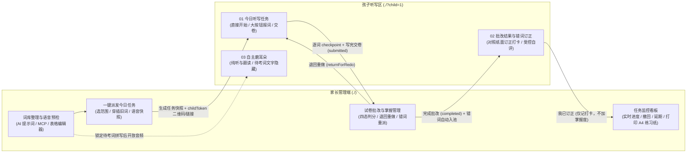
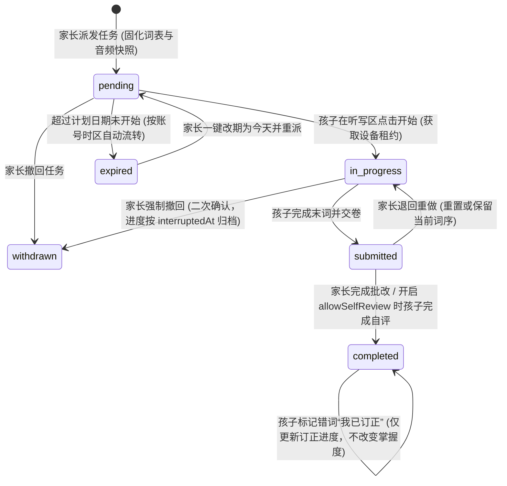
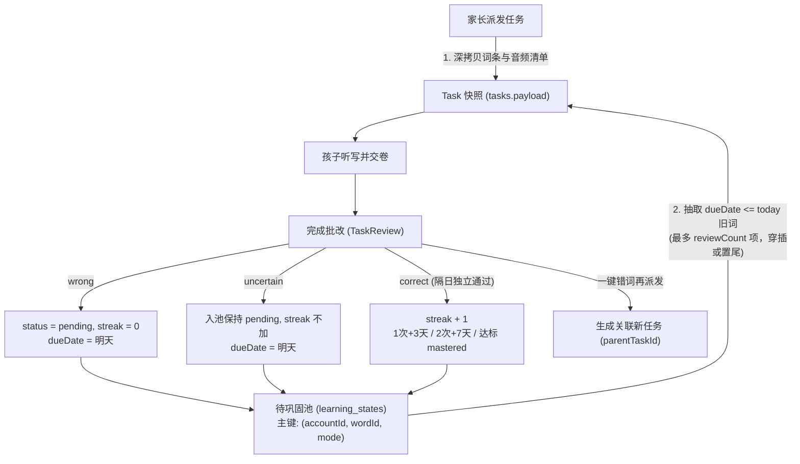

# 听写小站（OwnClass）双端架构与完整功能规范

本文档汇总并固化听写小站（OwnClass）的**家长端与孩子听写区双端隔离架构、6 态任务状态机、批改与长期掌握闭环、`childToken` 安全白名单、词表与语音准备、AI/MCP 接入及 A4 打印规范**，作为当前实现与后续演进的权威基准文档。

## 当前实施口径（2026-11-03）

本项目是家庭纸笔练习工具，以顺畅完成「安排 → 听写 → 交卷 → 批改 → 订正」为目标。保留已有登录、账号归属和孩子入口；本轮不增加考试级防作弊、复杂权限或新基础设施。验收结论以 [实施进度](实施进度.md)、[界面验收](界面验收.md) 和 [真机验收](真机验收.md) 为准，不将代码存在等同于硬件验收通过。

---

## 一、 总体架构与双端角色闭环

系统围绕 **“派发（家长）→ 执行（孩子）→ 批改（家长 / 受控自评）→ 订正与隔日掌握（孩子 + 系统）”** 构建清晰的角色闭环，严格隔离家长管理端与孩子听写区：

### 1.1 双端职责与入口隔离矩阵

| 维度           | 家长管理端（`./`）                                                                                 | 孩子听写区（`./?child=1`）                                                                                |
| :------------- | :------------------------------------------------------------------------------------------------- | :-------------------------------------------------------------------------------------------------------- |
| **访问凭证**   | 账号密码会话（Cookie `HttpOnly`）                                                                  | 独立高熵免密凭证 `childToken`（`?child=1&ct=ct_...` 扫码/链接打开并自动抹除地址栏参数）或同机新标签页跳转 |
| **核心导航**   | `今日任务` / `词库` / `待巩固` / `记录` / `连接与账号` + 顶部 `孩子听写区 ↗` 弹窗入口              | 独立顶栏与三大板块：`01 今日听写任务`、`02 批改结果与错词订正`、`03 自主磨耳朵（纯听与跟读）`             |
| **词库与编辑** | 完整表格化词表编辑、读音状态实时检测、整表/单条试听、AI 草稿核对                                   | **完全隐藏**词表编辑、连接设置与未锁定词库管理                                                            |
| **听写执行权** | **仅负责派发、监控进度、打印练习纸、撤回与批改**；不展示“开始听写”或播音做题界面，杜绝双端职责混淆 | **唯一听写执行端**：直接开始、按词播报、断点续传与交卷                                                    |
| **答案可见性** | 随时查看词表答案、批改已交卷任务                                                                   | 听写投影省略 `answer`/`alt`，保留设备朗读所需 `audioText`；磨耳朵界面隐藏待考词文字                       |

---

## 二、 任务模型：6 态生命周期、并发与异常边界规则

### 2.1 任务状态机（Task & Attempt State Machine）

任务生命周期由 `pending`、`in_progress`、`submitted`、`completed`、`withdrawn`、`expired` 六种状态构成，配合 `attempt` 的做题/中断/批改/订正子状态：

### 2.2 状态转换与权限规则

| 当前状态      | 触发动作                                          | 目标状态      | 允许角色                                | 服务端核心规则与副作用                                                                                                                                 |
| :------------ | :------------------------------------------------ | :------------ | :-------------------------------------- | :----------------------------------------------------------------------------------------------------------------------------------------------------- |
| `[*]`         | 派发任务 (`POST /api/tasks`)                      | `pending`     | 家长                                    | 深拷贝词条快照与待巩固穿插项，生成 `task.revision = 1`，写审计日志 `task.dispatched`                                                                   |
| `pending`     | 修改任务 (`PUT /api/tasks/:id`)                   | `pending`     | 家长                                    | 校验 `revision` 乐观锁，重新生成快照，`revision + 1`                                                                                                   |
| `pending`     | 开始听写 (`POST /api/tasks/:id/start`)            | `in_progress` | 孩子                                    | 校验单任务互斥（无其他 `in_progress` 任务），分配设备租约 `activeDeviceId` 与 `heartbeatAt`                                                            |
| `pending`     | 撤回任务 (`POST /api/tasks/:id/withdraw`)         | `withdrawn`   | 家长                                    | 任务移出待办队列，写审计日志 `task.withdrawn`                                                                                                          |
| `pending`     | 跨日过期检查                                      | `expired`     | 系统                                    | 当 `today > addDays(task.date, 1)`（账号时区）时自动归入已过期，家长可一键“改期为今天并重派”                                                           |
| `in_progress` | 单题推进 (`PUT /api/attempts/:id`)                | `in_progress` | 孩子                                    | 校验 `revision` 与 `activeDeviceId` 租约，按词持久化游标 `index` 并刷新 `heartbeatAt`                                                                  |
| `in_progress` | 强制撤回 (`POST /api/tasks/:id/withdraw`)         | `withdrawn`   | 家长                                    | **禁止编辑内容，仅允许二次确认后撤回**；当前 `attempt` 写入 `interruptedAt` 保留中断档案，孩子端在刷新、可见页面约 10 秒轮询或下一次同步发现撤回后停播 |
| `in_progress` | 写完交卷 (`PUT /api/attempts/:id`)                | `submitted`   | 孩子                                    | `attempt.phase = "review"`，`task.status = "submitted"`，触发家长端待批改置顶提醒与页签角标                                                            |
| `submitted`   | 退回重做 (`POST /api/tasks/:id/return`)           | `in_progress` | 家长                                    | 仅限待批改且无其他进行中任务；清除旧批改标记与设备占用，默认保留游标，可选重置 `index = 0`，记录 `task.returned`                                       |
| `submitted`   | 完成批改 (`POST /api/attempts/:id/complete`)      | `completed`   | 家长（或开启 `allowSelfReview` 的孩子） | 同一事务写入四态判分结果与 `learning_states` 掌握度变更，开启自评时随机生成 1–2 个 `spotCheckWordIds` 供家长抽查                                       |
| `completed`   | 标记已订正 (`POST /api/attempts/:id/corrections`) | `completed`   | 孩子 / 家长                             | 将 `wordId` 加入 `attempt.corrections`；**严格不触发掌握度晋升，不增加 `streak`**                                                                      |

### 2.3 五大并发与工程边界规则

1. **多任务排队与单任务互斥**：
   - 家长连续派发多个任务时，按派发时间排队进入孩子端“01 今日听写任务”；
   - 同一账号下，**同一时刻最多允许 1 个任务处于 `in_progress`**；若已有进行中任务，启动或退回另一任务时服务端返回 `409 请先完成或交卷当前正在进行的听写任务`。
2. **进行中禁止编辑，撤回保留中断记录**：
   - 一旦 `status !== "pending"`，`PUT /api/tasks/:id` 直接拒绝修改（`400`）；
   - 对 `in_progress` 任务点击“撤回任务”需二次确认，已听写进度记录 `interruptedAt` 留档备查，不静默丢弃。
3. **跨设备接力与多设备心跳租约（Device Lease）**：
   - 开始听写必须提供非空 `deviceId`，播放进度写入同样要求设备标识；接管会增加 `attempt.revision`，旧设备或旧版本不能覆盖新进度。家长批改继续使用版本校验，不受播放设备租约限制。
   - `attempt` 维护 `activeDeviceId` 与 `heartbeatAt`；
   - 若另一台平板在原设备心跳有效期内（30 秒内）打开同一进行中任务，前端提示**“该任务正在另一台设备上进行，是否在此设备接管并继续？”**，确认后传入 `forceTakeover: true` 无损接力。
4. **账号时区与过期重派**：
   - 日期计算统一基于账号偏好 `preferences.timezone`（默认 `Asia/Shanghai`）；
   - 过期未开始的任务归入折叠分组，支持家长一键“改期为今天并重派”（`POST /api/tasks/:id/reschedule`）。
5. **家长准备声音，孩子直接开始**：
   - 仅家长端使用 [`AudioPreparation.tsx`](../apps/web/src/AudioPreparation.tsx) 准备、预检和试听。孩子端不请求整卷准备接口，不等待整卷检查；开始后按词读取已有声音，缺失时直接用设备合成语音，读取超时（3 秒）或文件播放失败时同样兜底。
   - 做题切词遇瞬时断网时本地暂存游标并显示“尚未同步”横幅与重试按钮；**开始任务、交卷、完成批改**三个关键节点强制要求服务端落盘确认。

---

## 三、 批改闭环、错词本与长期掌握体系

### 3.1 四态判分与防阻塞批改机制

1. **“只点错词” + 四态判分（`correct` / `wrong` / `uncertain` / `unchecked`）**：
   - 批改页所有词条初始为 `unchecked`（未核对），绝不默认全对；
   - 家长只需点选错词（标为 `wrong`“再练一次”）或存疑词（标为 `uncertain`“不确定”）；
   - 点击完成批改时：
     - 勾选 **“已全部核对，其余正确”**（`confirmRemaining = true`）：未标记项及显式 `unchecked` 项转为 `correct`；
     - 未勾选（`confirmRemaining = false`）：未标记项保持 `unchecked`（不计入掌握通过次数，阶段复习中仍会作为未确认项列出）。
2. **可选“允许孩子自主核对 + 家长抽查”（`allowSelfReview`）**：
   - 家长派发任务时可勾选 **“允许孩子交卷后自主核对答案”**；
   - 开启后，孩子交卷即可在孩子端对照答案完成核对；系统自动从自评为 `correct` 的词中随机抽取 1–2 词记入 `spotCheckWordIds`，在家长端显著提示 **“建议抽查：xxx”**。
3. **退回重做（Return for Redo）**：
   - 针对孩子误交卷或漏写，`submitted` 状态下默认退回到交卷位置继续补写，可勾选“从头重写”。两种方式都清除旧批改标记，有其他进行中任务时提示先完成。
   - `submitted` 和 `completed` 任务不能重新开始；已批改后再练由家长复制新任务，原记录保留。

### 3.2 词表快照、错词入池与掌握度规则

- **派发强快照**：任务创建时将词条完整内容与音频清单固化在 `tasks.payload`，后续编辑或删除原词表不影响已派发任务和历史记录。音频由家长预先准备；孩子端按词使用已有音频，缺失或不兼容时使用机器朗读，题目范围与顺序不变。
- **按练法独立掌握（`accountId + wordId + mode`）**：例如同一单词在“听英语写英语（`en2en`）”与“看中文写英语（`zh2en`）”下分别独立累计掌握状态。
- **隔日独立通过累计（默认 3 次掌握）**：
  - 每次交卷固定 `submission.at` 与 `practiceDate`，以交卷时账号时区计算练习日期，批改时间不代替练习日期；退回重做后重新交卷会更新这一轮时间。补批按练习时间计算，每次批改保存当时的掌握阈值，修改时区或阈值不追溯改写已保存值。
  - 保留已有学习状态作为基线；手动掌握／恢复会建立新的基线，之前已交卷的迟批结果不覆盖手动操作，新交卷的练习正常生效。
  - 同日重复练习或同日曾写错（`lastQualifiedDate === today || lastWrongDate === today`）不重复递增 `streak`；
  - 批改为 `wrong` 立即清零 `streak = 0` 并于次日到期（即使此前已 `mastered` 也会重新入池）；
  - 批改为 `uncertain` 自动进入待巩固池（次日到期），且不增加 `streak`；
  - **订正与掌握严格解耦**：孩子在“02 批改结果与错词订正”中点击 **“我已订正”** 仅记录纸面订正打卡，不增加 `streak`。
- **错词一键重派**：已批改任务存在 `wrong` 或 `uncertain` 词条时，家长可点击 **“错词再派发一次”**（`POST /api/tasks/:id/redispatch-wrong`），自动打包生成关联原任务（`parentTaskId`）的新任务。

---

## 四、孩子入口凭证与文字展示规则

### 4.1 现有孩子接口白名单

孩子设备通过独立 `childToken`（`ct_...`）访问服务端时，鉴权中间件识别 `auth.role === "child"`，**仅放行以下白名单接口**，其余所有管理、词库增删改、账号与 AI 接口一律返回 `403 孩子听写区无权执行此操作`：

| 允许方法与路径                       | 用途说明               | 服务端安全门控约束                                                                                                      |
| :----------------------------------- | :--------------------- | :---------------------------------------------------------------------------------------------------------------------- |
| `GET /api/auth/me`                   | 会话与角色探测         | 返回 `role: "child"` 与账号偏好，不暴露管理数据                                                                         |
| `GET /api/child/overview`            | 孩子端三大板块聚合数据 | 仅返回今日任务、待订正错词摘要与纯听词表目录                                                                            |
| `GET /api/child/batches/:id/listen`  | 磨耳朵纯听/跟读词表    | 返回原词条供朗读，附 `lockedWordIds` 供界面隐藏文字（见 4.2）                                                           |
| `GET /api/tasks/:id/play`            | 获取听写播音队列       | 经 `projectTask` 省略 `answer` 与 `alt`；`audioText` 仍含朗读文本，不承诺防作弊                                         |
| `POST /api/tasks/:id/audio`          | 准备并校验任务音频     | 仅限待开始/进行中任务                                                                                                   |
| `GET /audio/:file`                   | 读取本账号音频流       | 校验 `store.hasAudio(accountId, file)`                                                                                  |
| `POST /api/tasks/:id/start`          | 开始听写               | 校验单任务互斥与设备租约                                                                                                |
| `PUT /api/attempts/:id`              | 上报做题游标与交卷     | 当 `!task.allowSelfReview` 时，**服务端强制忽略客户端传入的判分 `results`**                                             |
| `GET /api/attempts/:id`              | 读取批改/核对详情      | **仅当 `task.status === "completed"` 或 (`task.allowSelfReview && attempt.phase === "review"`) 时放行**，否则返回 `403` |
| `POST /api/attempts/:id/complete`    | 提交孩子自主核对       | **仅当 `task.allowSelfReview === true` 时放行**，否则返回 `403`                                                         |
| `POST /api/attempts/:id/corrections` | 标记错词“我已订正”     | 仅限 `completed` 任务中的错词 ID                                                                                        |

### 4.2 待考词文字隐藏

当孩子存在未完成或待批改任务（`status IN ("pending", "in_progress", "submitted")`）时，服务端收集这些任务涉及的所有 `wordId` 集合 `lockedWordIds`：
- 孩子磨耳朵接口返回原词条与 `lockedWordIds`，前端隐藏命中项的文字，显示“待考词 · 只听声音”，批改后恢复文字；
- 设备合成语音需要实际中英文本。原先服务端将文本改成“待考词”会导致浏览器也朗读占位词，本轮已修复。此处是练习中的视觉提示，不是答案保密或考试级隔离；不为此引入代理语音、加密题库或额外权限层。

### 4.3 令牌哈希存储、URL 抹除与访问审计

- **高熵生成与哈希落库**：采用 `crypto.randomBytes(24)` 生成 `ct_<base64url>`，数据库仅保存 `SHA-256` 摘要与有效期（默认 30 天），支持家长在弹窗内**一键重置链接（Rotate）**使旧二维码立即失效。
- **地址栏无痕化**：孩子端首次打开 `/?child=1&ct=ct_...` 时，前端将令牌写入 `localStorage` 后立即调用 `history.replaceState` 抹除 URL 中的 `ct` 参数。
- **设备访问记录与审计日志**：记录孩子端最近访问设备简述与时间（展示在家长端“孩子听写区入口”弹窗），关键操作（派发、撤回、退回、批改、重置链接）统一写入 `audit_logs`。

---

## 五、 词表准备、AI/MCP 接入、A4 打印与界面体验

### 5.1 表格化词表编辑与语音状态可视化

- **结构化 AI 提示词**：新建词表“使用自己的 AI 整理”明确要求输出顶层元数据（`title` 词表名称、`grade` 年级、`unit` 单元、`source` 教材或来源）及完整词条属性，不再堆叠混杂。
- **单行列表式工作台（[`Editor.tsx`](../apps/web/src/Editor.tsx)）**：弃用碎片化的窄卡片，采用清晰的四列宽幅表格（`序号/类型`、`英文/词语与答案`、`中文释义/拼音/提示`、`发音配置与状态 badge + 单行试听`），查看每项读音与音频状态；手机端按行纵向排列。编辑已有词表时折叠导入区，新建时默认展开。
- **家长端预检试听（[`BatchDetail.tsx`](../apps/web/src/BatchDetail.tsx)）**：提供“01 派发到孩子听写区”与“02 词表内容与语音预检（支持整表纯听预检与逐行试听）”。

### 5.2 AI 连接与 MCP 双模式配置（[`Connections.tsx`](../apps/web/src/Connections.tsx)）

- 家长端“连接与账号”支持生成带最小权限（`wordlists:read`、`drafts:write`）的专用令牌；
- 同时提供 **远程 HTTP MCP JSON 配置**、**本地 `stdio` MCP 桥接配置** 以及 **REST API `curl` 示例**，支持一键复制接入 Claude Code、Cursor、Claude Desktop 等客户端；AI 创建的草稿须经家长在网页端核对确认后才正式入库。

### 5.3 A4 紧凑三栏练习纸与汇报卡（[`PrintView.tsx`](../apps/web/src/PrintView.tsx)）

- 支持 **听写空白纸（`blank`）**、**看拼音写词语纸（`pinyin`）**、**待巩固练习纸（`review`，待巩固数 > 0 时可选，为 0 时明确提示原因）** 三种纸型；
- 采用标准 **A4 页面紧凑排版**：单词/短语自动使用 **3 栏网格（`grid-template-columns: repeat(3, 1fr)`）**，长句自动跨满整行（`grid-column: 1 / -1`），20–30 词稳妥排入单张 A4 纸，答案页默认关闭且物理隔离；
- 批改完成后支持一键生成 Canvas **PNG 汇报卡**（含本次正确、待巩固、未核对与订正统计，可选嵌入本机纸面照片，不上传云端）。

### 5.4 `/better-interface` 视觉、触控与无障碍规范

- **双端视觉锚点区分**：家长端采用冷静高效的工坊工作台风格；孩子端采用专注纸感、大触控热区（核心按钮 `>= 44px–48px`）与进度条防焦虑设计。
- **无障碍与对比度**：主要进度数字与计时器启用 `font-variant-numeric: tabular-nums`；浅色/深色主题复用现有语义变量，已检查组合的对比度与范围见界面验收，未宣称全站 WCAG 认证；仅在 `@media (hover: hover)` 设备启用悬停态，保障平板与手机触控体验。
